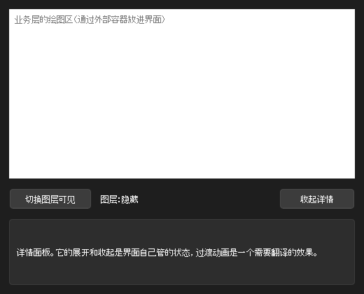
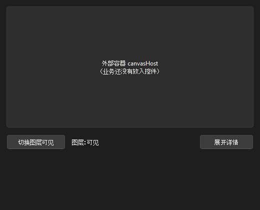

# 最小例子：从设计项目导出成 Qt

这个文件夹演示整条线：在工具里写界面，一键导出成 Qt 工程，业务从接口接进来。对应 `计划-AnimeAn界面翻译.md` 里“步骤”的第 1 项。



上图是导出后接上业务的程序。上半部分的白色区域是业务层的绘图区，通过外部容器放进界面；下面的按钮、文字和详情面板是导出的界面。

## 里面有什么

```text
examples/minimal/
  design/            设计项目：在工具里打开、预览、修改的就是它
  qt/                一个假的业务工程，用来示范怎样把导出的界面接进来
    ui/              ← 从 design/ 导出的界面
      ui_binding/          界面绑定层      工具生成
      business_interface/  业务接口层      工具生成
      ui_interface/        界面接口层      工具生成
      ui_effects/          界面效果层      Agent 翻译，导出时不覆盖
      preview/             不接业务的预览程序   工具生成
      AGENTS.md            给 Agent 的规则      工具生成
      INTERFACE.md         接口清单和变化       工具生成
    business/        业务层：一个假的数据模型和一个假的绘图区
    app/             业务和业务接口之间的连接（Connect.cpp），以及程序入口
    violations/      故意越界的代码，用来证明分层约束能被编译检查出来
```

`qt/ui/` 里除了 `ui_effects/`，都是导出器生成的，不要手改。`qt/business/`、`qt/app/`、`qt/violations/` 和 `qt/ui/ui_effects/` 里的 Qt 实现是手写的。

## 怎样重新导出

在仓库的 `app/` 文件夹里运行（需要先 `npm install`）：

```bash
npm run export:qt -- ../examples/minimal/design
```

导出到哪里写在 `design/project.json` 的 `export.qt` 里。导出器会报告生成了多少文件、接口有没有变化。内容没变的文件不会重写。

## 怎样构建和运行

需要 Qt 6（含 Widgets 和 Qml）、CMake 和 Ninja。本机的路径如下，用 Git Bash，在 `examples/minimal/qt/` 里运行：

```bash
export PATH="/c/Qt/Tools/CMake_64/bin:/c/Qt/Tools/Ninja:/c/Qt/Tools/mingw1310_64/bin:/c/Qt/6.9.1/mingw_64/bin:$PATH"
```

```bash
cmake -S . -B build -G Ninja -DCMAKE_BUILD_TYPE=Release -DCMAKE_PREFIX_PATH=C:/Qt/6.9.1/mingw_64
```

```bash
cmake --build build
```

```bash
./build/app/vf_minimal.exe
```

| 程序 | 是什么 |
| --- | --- |
| `build/app/vf_minimal.exe` | 接了业务的完整程序 |
| `build/ui/preview/vf_preview.exe` | 只有界面的预览程序。单独构建 `qt/ui/` 也能得到它 |

`vf_minimal.exe` 的参数：

| 参数 | 作用 |
| --- | --- |
| `--no-business` | 不接业务。界面照样能用，业务管的状态走设计项目里写的模拟步骤 |
| `--no-effects` | 不提供效果。界面照样能用，只是没有过渡动画 |
| `--steps "步骤;步骤"` | 按步骤自动操作一遍，打印每一步的输出，然后退出 |

步骤的写法见 `qt/ui/ui_binding/UiDriver.h`，例如 `click:toggleButton`、`wait:400`、`state`、`check`。

## 验证了什么

以下结果是 2026-10-12 在本机得到的（Qt 6.9.1 mingw）。

### 1. 导出的工程能编译运行，四种组合行为都对

用同一串步骤：点“切换图层可见”，点“展开详情”，过 60 毫秒量一次面板高度，再过 400 毫秒量一次。

```bash
./build/app/vf_minimal.exe --steps "click:toggleButton;check;click:expandButton;wait:60;size:detailPanel;wait:400;size:detailPanel;check"
```

| 业务 | 效果 | 点“切换图层可见”之后 | 点“展开详情”之后 |
| --- | --- | --- | --- |
| 接上 | 有 | 业务模型变为隐藏，**只被改了 1 次**；绘图区在外部容器里 | 过渡中高度 58，结束时 96 |
| 没接 | 有 | 界面状态变为隐藏（模拟步骤）；业务模型没有被碰 | 过渡中高度 57，结束时 96 |
| 接上 | 没有 | 同第一行 | 高度直接是 96，没有过渡 |
| 没接 | 没有 | 同第二行 | 同上 |

每一步之后的 `check` 都输出 `check ok`：各控件实际的可见、可用和文字，和逻辑算出来的一致。过渡中的高度每次运行会差一两个像素。

不接业务时，外部容器里是占位的文字：



### 2. 工具里和导出的程序里，状态逐字相同

同一串步骤在工具这一侧跑一遍（在 `app/` 里）：

```bash
npm run case -- ../examples/minimal/design "state;click:toggleButton;state;click:expandButton;state"
```

它输出的每一行 `state {...}`（全部状态，加上每个控件应有的可见、可用和属性），和 `vf_minimal.exe --steps` 输出的对应行逐字相同。四种组合都比过。原因是两边运行的是同一份逻辑代码：导出时把工具的逻辑运行层打包成一个脚本，放进 Qt 自带的 JS 引擎里运行。

### 3. 分层的约束由编译把关

```bash
ctest --test-dir build
```

七段故意越界的代码全部被拦住（`100% tests passed, 0 tests failed out of 7`）：界面效果层包含业务层或界面绑定层的头文件、界面绑定层包含业务层的头文件、业务层或业务连接代码包含界面绑定层的头文件、效果的哈希对不上、用 `../` 绕过分层。

### 4. 设计项目里改了效果，Qt 那边旧的翻译编译不过

把 `design/effects/PanelExpand/index.js` 里的时长从 180 改成 240，重新导出，导出器报告：

```text
接口和上一次导出相比有变化：
  - 效果 PanelExpand：在工具里的实现改了，哈希从 77a08c49 变成 640a41f7，需要对照 effects/PanelExpand/index.js 重新翻译
```

这时构建失败，GCC 的输出指到了旧翻译所在的那一行：

```text
ui/ui_effects/PanelExpandEffect.h:11:41:   required from here
ui/ui_interface/UiEffects.h:29:24: error: static assertion failed: [VF-EFFECT-HASH] 效果 PanelExpand 在工具里的实现已经改变，现在的哈希是 640a41f7。这个实现是照着旧哈希写的，请对照工具里的新实现（effects/PanelExpand/index.js）重新翻译，再把基类改成 vf::PanelExpandEffect<0x640a41f7>。
```

改回 180 再导出，哈希回到 `77a08c49`，构建通过。

### 5. 重复导出结果不变

设计项目没有改动时再导出一次，导出器报告“内容有变化的 0 个”，`ui_effects/` 里手写的文件没有被碰。

## 在工具里打开这个设计项目

工具默认打开仓库里的 `project/`。要打开这个例子，启动前把环境变量 `VF_PROJECT` 设成 `design/` 的路径。在 `app/` 里：

```bash
VF_PROJECT=../examples/minimal/design npm run dev
```

然后打开 <http://localhost:1420>。切到预览模式，点“切换图层可见”，事件记录里能看到业务事件走的是模拟步骤；点“展开详情”，面板带着过渡展开。
