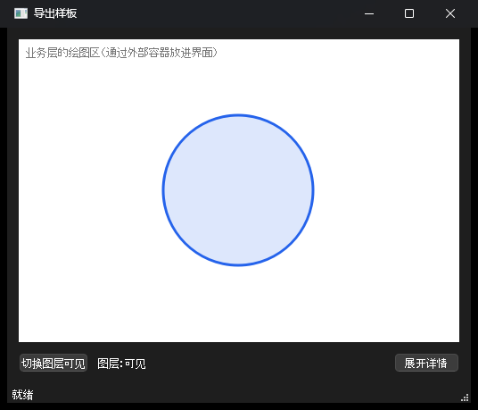

# 导出样板：一个最小项目导出成 Qt 之后的样子

这个工程是**手工写的**，不是工具生成的。它回答一个问题：工具把设计项目一键导出成 Qt 时，应该生成成什么样。之后写导出器，就以这里的结构为目标。

> **导出器已经写好了（2026-10-12）。** 由导出器生成的同一个界面在 `examples/minimal/`，以那里为准。这个文件夹保留下来，是因为第 4 节“Qt 能画出哪些 SVG”的试验还在这里。导出器和这份样板有三处不同：
>
> - 逻辑不再是手写的一小段，而是工具的逻辑运行层原样打包，作为资源文件编进程序（这里是写在 `LogicScript.cpp` 里的字符串）。
> - 效果只管播放，放完通知界面；控件最终显示还是隐藏由界面绑定层决定（这里是效果自己负责）。所以抽象类的函数多了一个参数：`play(QWidget *target, bool showing, std::function<void()> finished)`。
> - 导出的界面自成一个文件夹，业务工程把它整个引入；界面效果层在这个文件夹里面（这里五层是并排的）。

对应的计划见仓库根目录的 `计划-AnimeAn界面翻译.md`，这是其中的第一步。



窗口里有：一个外部容器（放着业务层的绘图区）、一个“切换图层可见”按钮和旁边的文字、一个“展开详情”按钮和它控制的面板。

## 五层各在哪

```text
业务层      →  业务接口层  ─┐
                           ├→  界面绑定层
界面效果层  →  界面接口层  ─┘
```

| 文件夹 | 层 | 内容 | 谁来写 | 能包含谁的头文件 |
| --- | --- | --- | --- | --- |
| `ui_binding/` | 界面绑定层 | 控件树、位置、排版、事件、状态和逻辑 | 工具生成 | 两个接口层、Qt |
| `business_interface/` | 业务接口层 | 事件、业务管的状态、请求、外部容器 | 工具生成 | Qt |
| `ui_interface/` | 界面接口层 | 每个“需要翻译”的效果：一个抽象类加一个哈希 | 工具生成 | Qt |
| `ui_effects/` | 界面效果层 | 效果在 Qt 里的实现 | Agent 翻译 | 界面接口层、Qt |
| `business/` | 业务层 | 数据模型，以及业务自己的控件（假的绘图区） | 业务项目 | Qt |
| `app/Connect.*` | 业务和业务接口之间的连接 | 只做转发和数据转换 | Agent | 业务层、业务接口层 |
| `app/main.cpp` | 程序入口 | 把各层装到一起 | 工具生成 | 全部 |

## 构建和运行

需要 Qt 6（含 Widgets、Qml、Svg）、CMake 和 Ninja。本机的路径如下，用 Git Bash 运行：

```bash
export PATH="/c/Qt/Tools/CMake_64/bin:/c/Qt/Tools/Ninja:/c/Qt/Tools/mingw1310_64/bin:/c/Qt/6.9.1/mingw_64/bin:$PATH"
```

```bash
cmake -S . -B build -G Ninja -DCMAKE_BUILD_TYPE=Release -DCMAKE_PREFIX_PATH=C:/Qt/6.9.1/mingw_64
```

```bash
cmake --build build
```

```bash
./build/app/vf_sample.exe
```

`vf_sample.exe` 的参数：

| 参数 | 作用 |
| --- | --- |
| `--no-business` | 不接业务。界面照样能用，“业务管”的状态由模拟步骤处理 |
| `--no-effects` | 不提供效果。界面照样能用，只是没有过渡动画 |
| `--selftest` | 自动点一遍按钮，把每一步之后的状态打印出来，然后退出 |

## 验证了什么

### 1. 能编译运行，四种组合行为都对

`--selftest` 在四种组合下的结果（2026-10-12，Qt 6.9.1 mingw）：

| 业务 | 效果 | 点“切换图层可见”之后 | 点“展开详情”之后 |
| --- | --- | --- | --- |
| 接上 | 有 | 界面状态变为隐藏；业务模型变为隐藏，**只被改了 1 次** | 面板可见；过渡中高度 27，结束时 46 |
| 没接 | 有 | 界面状态变为隐藏（模拟步骤）；业务模型没有被碰 | 同上 |
| 接上 | 没有 | 同第一行 | 面板可见；高度直接是 46，没有过渡 |
| 没接 | 没有 | 同第二行 | 同上 |

这说明三件事：

- 业务接上以后，界面不会自己再改一次状态（模型只被改了 1 次）。
- 业务没接时，界面靠模拟步骤照样能用。
- 效果没提供时，行为不受影响，只是少了动画。

“业务有没有接”是自动判断的：绑定层发事件前检查这个信号有没有被连接（`QObject::isSignalConnected`），没有就执行模拟步骤。业务那边不需要另外声明。

### 2. 分层的约束由编译把关

每一层是一个独立的库，它的包含路径里只有自己和它链接的层。包含别的层的头文件，编译器直接报找不到文件。用 `../` 绕过去的写法，由配置阶段的检查拦住（`cmake/LayerRules.cmake`）。

`violations/` 里是七段故意越界的代码，`ctest` 逐个去编译它们，确认它们失败，而且是因为预期的原因失败：

```bash
ctest --test-dir build
```

| 测试 | 越界的做法 | 结果 |
| --- | --- | --- |
| `violation_effects_include_business` | 界面效果层包含业务层的头文件 | 编译失败：`LayerModel.h: No such file or directory` |
| `violation_effects_include_binding` | 界面效果层包含界面绑定层的头文件 | 编译失败：找不到 `Ui.h` |
| `violation_binding_include_business` | 界面绑定层包含业务层的头文件 | 编译失败：找不到 `LayerModel.h` |
| `violation_business_include_binding` | 业务层包含界面绑定层的头文件 | 编译失败：找不到 `Ui.h` |
| `violation_connection_include_binding` | 业务连接代码包含界面绑定层的头文件 | 编译失败：找不到 `Ui.h` |
| `violation_effect_hash_mismatch` | 效果实现照着写的哈希和接口里现在的不一致 | 编译失败，见下 |
| `violation_relative_include` | 用 `../business/LayerModel.h` 绕过分层 | 配置阶段报错 |

七个全部通过。

### 3. 效果的哈希对不上，编译报出看得懂的错误

界面接口层里，每个效果要实现的抽象类，名字里带着哈希。效果的实现就继承这个带哈希的类：

```cpp
class PanelExpandAnimation : public vf::PanelExpandEffect<0x3fa2c1>
{
public:
    void play(QWidget *panel, bool expanding) override;
};
```

工具里这个效果改了，重新导出后接口里的哈希就变了。只有哈希等于当前值的那个类是真正的抽象类；其余任何哈希都会落到一个只负责报错的模板上。所以照着旧哈希写的实现编译不过，GCC 的实际输出：

```text
ui_interface/UiEffects.h: In instantiation of 'class vf::PanelExpandEffect<0>':
violations/effect_hash_mismatch.cpp:5:37:   required from here
ui_interface/UiEffects.h:28:24: error: static assertion failed: [VF-EFFECT-HASH] 效果 PanelExpand 在工具里的实现已经改变，现在的哈希是 3fa2c1。这个实现是照着旧哈希写的，请对照工具里的新实现重新翻译，再把基类改成 vf::PanelExpandEffect<0x3fa2c1>。
```

第二行指出了是哪个实现文件的哪一行。

因为哈希是类名的一部分，这里没有可以绕过的检查：哈希不对，就没有可以继承的类，也交不进界面接口层（接收效果的函数只认当前哈希的那个类）。

机制管不了的只有一件事：有人把哈希改成新的，却没有真的重新翻译。这要靠规则文件约束。

### 4. Qt 6.9.1 能画出哪些 SVG

`svg_test/` 把 `svg_test/svg/` 里的六个文件用 Qt 渲染成图片，结果存在 `docs/`。

```bash
./build/svg_test/vf_svg_test.exe svg_test/svg build/svg_out
```

| 写法 | 结果 | 看哪张图 |
| --- | --- | --- |
| 圆角矩形、虚线描边、路径、半透明 | 能画 | `docs/1-basics.png` |
| 文字（含中文，用系统字体） | 能画 | `docs/1-basics.png` |
| 线性渐变、径向渐变 | 能画 | `docs/2-gradient.png` |
| 模糊 `feGaussianBlur` | 能画，发光效果正常 | `docs/4-blur-glow.png` |
| 偏移 `feOffset`、合并 `feMerge` | 能画 | `docs/6-shadow-variants.png` 上排 |
| 填色 `feFlood`、合成 `feComposite` | 能画 | `docs/6-shadow-variants.png` 左下 |
| 遮罩 `mask` | 能画 | `docs/5-clip-mask-css.png` 中间 |
| `<style>` 里用类名写样式 | 能画 | `docs/5-clip-mask-css.png` |
| `<use>` 重复使用图形 | 能画 | `docs/5-clip-mask-css.png` 右侧 |
| 阴影 `feDropShadow` | **画不出**，图形本身照画，阴影没有 | `docs/3-shadow.png` 左 |
| `feComponentTransfer` | **画不出**，而且会让整个滤镜失效 | `docs/3-shadow.png` 右 |
| 裁剪 `clip-path` | **不生效**，图形没有被裁 | `docs/5-clip-mask-css.png` 左 |

由此得出给 Agent 写 SVG 的规则：

- 阴影不要用 `feDropShadow`。用“模糊 `SourceAlpha`、偏移、合并”三步，或者更简单：先画一个模糊的深色形状，再在上面画清晰的形状。
- 不要用 `feComponentTransfer`。要让阴影变淡，直接给那个深色形状设透明度。
- 不要用 `clip-path`。需要裁出形状时用 `mask`，或者直接把形状画成想要的轮廓。
- 没有试过的写法（CSS 变量、图案填充、混合模式、SVG 自带的动画等）先当作不支持，用到时再加进这个试验。

还有一个坑：用 `offscreen` 平台运行时，文字会画成方块。那是因为这个平台没有字体，和 SVG 模块无关。用正常平台运行就没有问题。

## 写导出器时要照着做的几点

1. 每一层一个 CMake 库，用 `vf_add_layer` 声明，它会顺带检查包含写法。
2. 业务接口层的类带 `Q_OBJECT`，所以它是一个要编译的库，不是纯头文件。
3. 绑定层的界面类直接继承业务接口，这样它才能用 `isSignalConnected` 判断业务有没有接上。
4. 逻辑脚本以原始字符串的形式编进绑定层，由 `QJSEngine` 运行。导出的程序因此依赖 Qt 的 Qml 模块。
5. 控件的对象名用设计项目里的控件 ID，测试和调试都靠它找控件。
6. 界面效果层对外只暴露一个 `registerEffects` 函数，由程序入口调用。
7. 界面接口层里，每个效果生成一个以哈希为模板参数的类：通用版本只含一条报错，当前哈希的特化版本才是要实现的抽象类。不要给当前哈希的类起一个不带哈希的别名，否则实现可以继承别名而躲开哈希。
